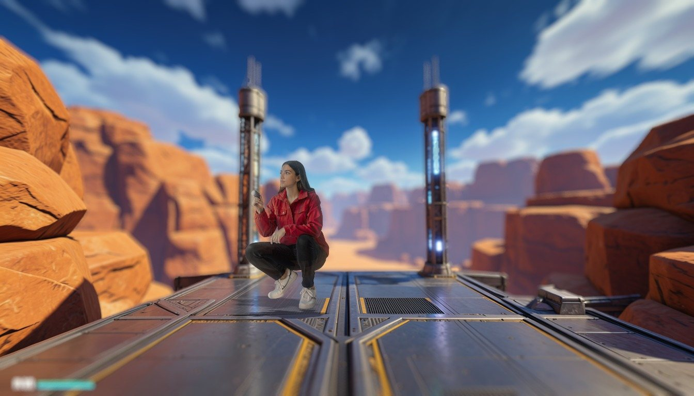
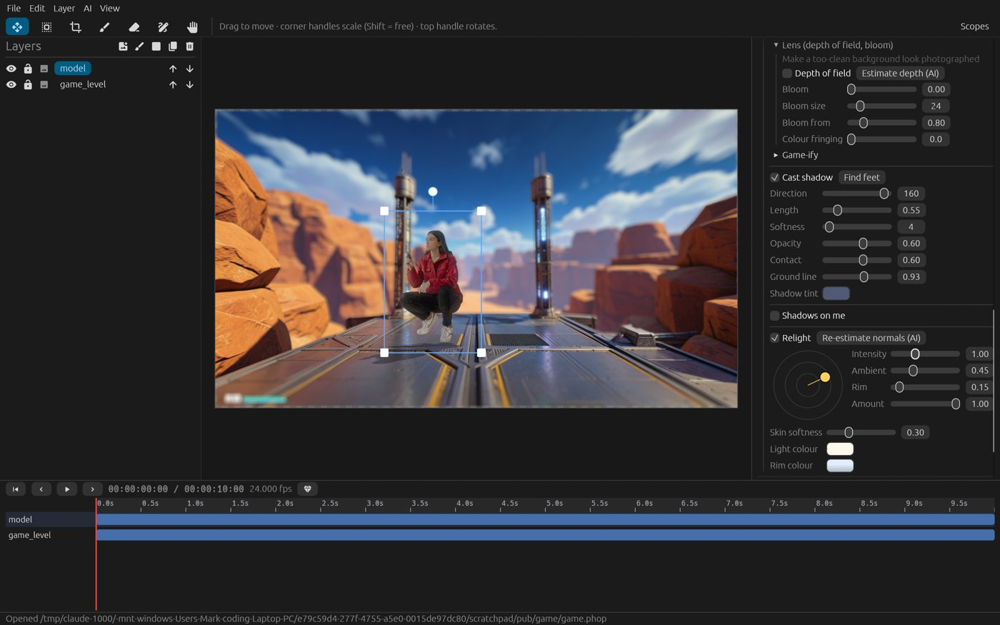
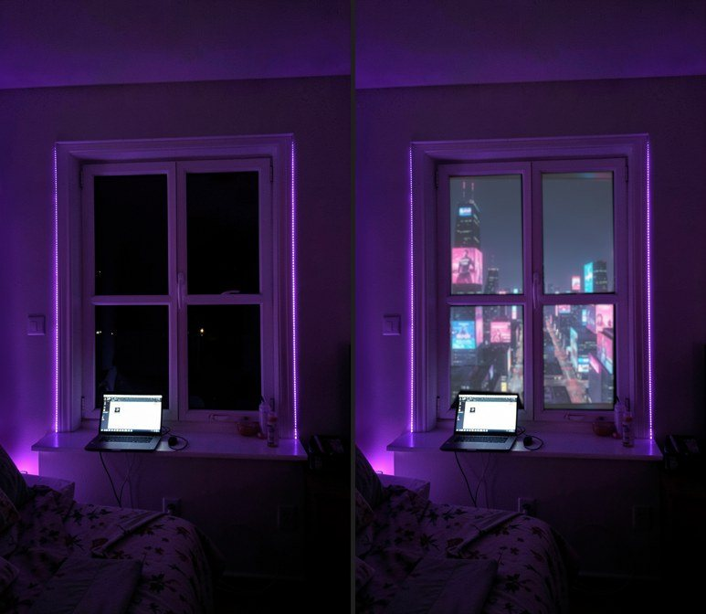

# PhotoHop

Put yourself into any scene — a game map, a wallpaper video, your own Blender render, a real photo —
and make it look like you were actually there. PhotoHop is a focused photo **and** video compositor:
cut yourself out, place yourself in the new background, then match lighting, colour, shadows, grain
and lens look so the result reads as one image.



| The app | Replace window / screen |
|---|---|
|  |  |

*Example images were generated for the docs.*


It is deliberately small: only the parts of a GIMP + DaVinci Resolve workflow this job needs.

> **Status: feature-complete for the core workflow** (v0.4): editing, masks and roto, grading and
> matching, relighting and shadows, AI cutouts / auto colour / object removal, 3D camera solve, body
> motion and the Blender round-trip. Expect rough edges.

## What works now

- Photos (PNG, JPEG, WebP, TIFF, EXR) and video (MP4, MOV, MKV, WebM…) as layers on one timeline
- GPU compositing in scene-linear float (wgpu): correct blending, no 8-bit banding
- 19 blend modes with GIMP-compatible maths (Normal, Multiply, Screen, Overlay, Soft/Hard light,
  Add, Subtract, Difference, Dodge, Burn, Grain extract/merge, Luminance, …)
- Move / scale / rotate with on-canvas handles, opacity, per-layer timing (start, source in point)
- Keyframes on position, scale, rotation, opacity (and colour layers), with auto-key mode
- Crop, paint layers with a soft brush and eraser (pressure-free for now), colour layers
- Per-layer colour grade: exposure, temperature/tint, lift/gamma/gain colour wheels, contrast/pivot,
  saturation — all keyframable
- **Match colour** without AI — *Surroundings* (default) matches your black level and colour cast to the
  scene right around you, like a colourist would; also colour cast only, tone only, or full transfer
- Layer masks: paint to hide (brush) or reveal (eraser), invert, toggle
- Selections straight into masks (M): rectangle, ellipse, lasso, magic wand; Shift adds, Alt subtracts, feather
- **Replace window / screen** (AI menu): show another clip through a window, TV or phone screen in
  four steps: *Find with AI* turns each pane into an editable shape, choose the clip (auto-fitted,
  looped), set how much reflection stays on the glass, and box anything moving in front of it so
  AI keeps it on top. Handheld shot? **Follow the camera** tracks the window frame (no AI) and
  keyframes the panes and the view so they stay locked to the window
- **Shadows on me** (Integration): leaf or window shadows in the scene fall on you too. PhotoHop
  reads where the ground is sunlit and looks it up along your cast-shadow direction from the bottom
  of your silhouette, so the gaps in the leaves line up; your own shadow only darkens sunlit ground
- **Lens** (Integration): depth of field from an AI depth map (click to pick the focus), bloom around
  bright lights and colour fringing, to make a too-clean background look photographed; Replace window
  gets *Match the camera* (softness and noise of your shot), out of focus, haze, grain and glow.
  Layers placed on a depth-of-field background get the same blur as the ground they stand on
- Bezier roto shapes (P): click points, drag curve handles, close on the first point; Add / Subtract,
  invert, feather, opacity; keyframe the whole shape (◆) so it follows motion. Combined with AI / painted masks
- Scopes (S): waveform, RGB parade, vectorscope with skin-tone line, histogram
- **Integration**: light wrap, blur/sharpen, motion blur, film grain, cast + contact shadow (auto-detects the feet;
  sharp at the feet and softer further out, a **Thickness** so side light doesn't throw a paper-thin
  line, and an on-canvas handle to drag the shadow's tip onto the scene's own shadows),
  and **relighting** from AI-estimated normals with a drag-the-sun light pad, rim light and soft
  skin falloff — shading changes only, never repainted pixels
- **Body-shaped shadow** (AI): rebuilds you in 3D from your photo (SAM 3D Body) and projects that body
  onto the ground along the light, so the cast shadow starts at your feet and has your real shape
- **One-click matching without AI**: *Match the camera* (grain, softness and **motion blur** of the
  background around you: a blurry street blurs you the same way), match light (colour, ambient, direction)
  to the background; atmospheric haze; optional **game-ify** (pixelate / posterize)
- **Video masks** (AI): cut yourself out of a whole clip, or draw a box to track a region (e.g. a
  window) and replace what's behind it; **Follow tracked region** keyframes another layer to move with it
- **Blender round trip**: File > Export to Blender writes a bundle; the PhotoHop Bridge add-on
  (`photohop_bridge.zip` on the Releases page) builds the scene — matching camera, you as a card that
  casts shadows and hides props behind you, a shadow-catcher floor at your feet, a sun from the Relight
  pad. Add props (e.g. a game weapon in your hand), Render for PhotoHop, then File > Import Blender render.
  For moving shots, run **AI > Video: solve 3D camera** first: the Blender camera then follows your
  phone's real movement (lens and floor included), so 3D props stay locked to the room.
  **AI > Video: capture body motion** (after the video cutout) adds your animated 3D body in Blender: it
  hides props that go behind you, casts real shadows onto props and the floor, and gives
  `PhotoHop right hand` / `PhotoHop left hand` empties — parent a game weapon to one and it follows
  your hand
- Curves (master / R / G / B, GIMP spline) and an HSL qualifier to select a colour range and shift its
  hue, saturation or brightness (with a matte view to check the selection)
- Undo/redo for everything, including brush strokes
- Video preview with background decoding, hardware decode and half/quarter-resolution proxies
- 10-bit and HDR video (HDR10/PQ, HLG, BT.2020) decoded at 16 bits into the linear working space
- Export the current frame (PNG 8/16-bit, JPEG, linear EXR) or the timeline as H.264, H.265 or
  ProRes 4444 with alpha, keeping the original audio
- Project files (`.phop`) that store media paths relative to the project

## Download

Grab the latest build from [Releases](https://github.com/MarkCockerill12/PhotoHop/releases):

- **Windows:** `PhotoHop-…-windows-x86_64.zip` — unzip and run `photohop.exe` (FFmpeg is included).
- **Linux:** `PhotoHop-…-linux-x86_64.tar.gz` — unpack and run `./photohop` (install FFmpeg from your
  distro, e.g. `sudo dnf install ffmpeg` or `sudo apt install ffmpeg`).

## Build from source

PhotoHop runs on **Linux and Windows** (any GPU with Vulkan, DirectX 12 or Metal).

1. Install [Rust](https://rustup.rs) (stable).
2. Install **FFmpeg** and make sure `ffmpeg` and `ffprobe` are on your `PATH`
   (Fedora: `sudo dnf install ffmpeg`; Windows: `winget install Gyan.FFmpeg`).
   You can also point PhotoHop at specific binaries with `PHOTOHOP_FFMPEG` / `PHOTOHOP_FFPROBE`.
3. Build and run:

```sh
cargo run --release -p photohop               # empty project
cargo run --release -p photohop -- photo.jpg  # open a photo, video or .phop project
```

## Shortcuts

| Key | Action | Key | Action |
|---|---|---|---|
| V | Move tool | Space | Play / pause |
| M | Select → mask (rect / ellipse / lasso / wand) | | |
| C | Crop tool (Enter applies, Esc cancels) | ← / → | Previous / next frame |
| B / E | Brush / eraser | Home | Go to start |
| P | Roto pen (Enter closes, Del removes point, Esc done) | | |
| H | Hand (pan) — or middle-drag / Space-drag | K | Toggle keyframes on the selected layer |
| S | Show / hide scopes | | |
| Ctrl+Z / Ctrl+Shift+Z | Undo / redo | Ctrl+0 | Fit canvas to window |
| Ctrl+O / Ctrl+S | Open / save project | Ctrl+I | Import media |
| Ctrl+D | Duplicate layer | Del | Delete layer |

Scroll to zoom (towards the cursor). In the Move tool, hold Shift for free scaling or 15° rotation steps.

## Roadmap

1. **Editing shell** — layers, timeline, keyframes, transforms, crop, paint, export *(done)*
2. **Masks & cutouts** — mask painting, selections, AI cutouts (photo + video), bezier roto shapes *(done)*
3. **Colour** — wheels, grade, non-AI matching, curves, HSL qualifier, scopes, HDR/10-bit video *(done)*;
   camera RAW (DNG) import, OCIO configs
4. **Integration** — relighting, cast/contact shadows, light wrap, grain, blur/sharpen *(done)*;
   automatic grain/sharpness and light matching, haze *(done)*; bloom
5. **Tracking** — AI region tracking + match-move, **3D camera solve** (Depth Anything 3, metric, with floor
   plane) driving the Blender camera *(done)*; point/planar trackers, stabiliser
6. **Blender round-trip** — bundle export, add-on, render import, camera solve and body motion export *(done)*
7. **AI auto-colour** and an optional "game-ify" look *(done)*

## AI (optional)

AI in PhotoHop is optional and limited by design: models may suggest **masks** and **colour / shading
parameters**, which PhotoHop then applies with its own deterministic maths — they never repaint your
pixels. The one exception is an opt-in inpainting step limited to the area a replaced prop no longer covers.

Models are downloaded separately, never bundled, and each keeps its own licence. Any model that
fits a task can be plugged in; the defaults below were benchmarked on an RTX 4070 (12 GB):

| Task | Default | Lighter / permissive alternatives |
|---|---|---|
| Photo cutout | BiRefNet_HR (MIT) | BiRefNet-lite, BEN2 |
| Video matting | MatAnyone 2 (S-Lab, non-commercial) | SAM 2.1 masks + refinement |
| Object / region tracking | SAM 2.1 large (Apache-2.0) | SAM 2.1 small/tiny |
| Human normals (relighting) | Sapiens2 1B | MoGe-2 normals |
| Scene depth | Depth Anything 3 Metric-Large (Apache-2.0) | MoGe-2, DA3 Giant (non-commercial) |

**Available now** (AI menu): **Auto colour** (Harmonizer predicts temperature / brightness / contrast /
saturation / highlights / shadows; PhotoHop applies the change as your layer's editable R/G/B curves —
the AI never touches your pixels), *Cut out subject* (BiRefNet), *Mask from text* (SAM 3, e.g. "person",
"toy gun"), *Video cutout* and *Track a region* (MatAnyone 2 / SAM 2.1), *Estimate normals* for relighting
(Sapiens2), and *Remove object* — the one tool that paints: FLUX.2 klein repaints only inside the
object's mask and the result arrives as a separate patch layer you can hide or delete. Results go straight into the layer's mask, where you can refine them with the brush, and
they are saved with the project. Setup: see [`ai/README.md`](ai/README.md) — works on CPU (≈40 s per
photo on a laptop) or much faster on an NVIDIA GPU.

## Licence

GPL-3.0-or-later — see [LICENSE](LICENSE). The Windows download bundles FFmpeg (GPL build from
[BtbN/FFmpeg-Builds](https://github.com/BtbN/FFmpeg-Builds), source and licence available there).
